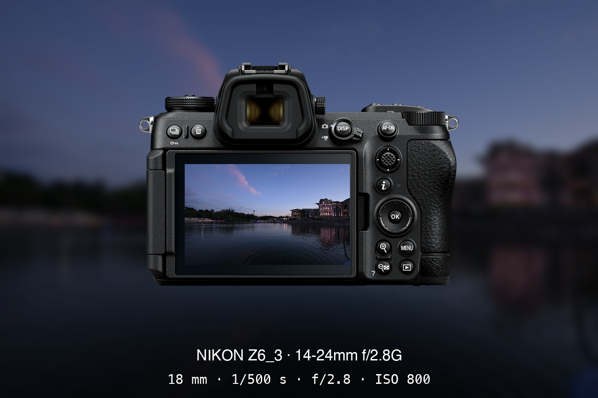

[English](README.md) | 中文

# see-through-camera

把照片装回它被拍下的地方 —— 合成进尼康机身的背面 LCD，下方居中渲染 EXIF 拍摄参数（焦距 · 快门 · 光圈 · ISO）。一个单一功能、纯客户端的「机身回屏卡」生成器。



## 特性

- **回屏卡片** —— 照片嵌入机身背屏，直角嵌入，原照片模糊后作背景
- **横竖自适应** —— 竖幅出竖幅、横幅出横幅；竖拍时机身同步立起（手柄朝上）
- **EXIF 驱动** —— 机型、镜头、焦距、快门、光圈、ISO 全部从照片自动读取，无需手填
- **机身 Profile 体系** —— 每台机身一个目录：官方产品图 PNG + 标定好的 LCD 屏幕四点坐标
- **两种使用方式** —— 现有 Python CLI；GitHub Pages 纯浏览器 Canvas 版（照片不出本地）

## 仓库结构

```
body_profiles/<body>/   body.png（官方产品图）+ profile.json（LCD 四点坐标、别名）
cli/watermark.py        Python CLI（Pillow）—— 从 JPEG 渲染回屏卡
web/                    GitHub Pages 前端（Canvas 移植，开发中）
docs/                   示例与标定记录
```

## CLI 用法

```bash
pip install pillow
python3 cli/watermark.py path/to/DSC_xxxx.JPG [--body z63]
```

机身根据照片 EXIF 机型字段自动匹配，`--body` 可强制指定；输出保存在 `output/` 目录。可选 `--bg soft|radial|solid` 选择背景处理方式（柔和虚化——默认、径向模糊——机身后面保持清晰边缘渐强虚化、纯色填充——照片平均色平铺）。

## 进度

- [x] Z6_3 —— 已标定
- [x] ZR / Z5 / Z8 / Z9 / Zf / Zfc —— 已标定（LCD 四点经 2 倍标尺放大人工读取）

## 素材与商标说明

机身产品图取自尼康官网产品页，版权归尼康公司所有。Nikon 及相关名称为尼康公司商标。本项目为独立的社区工具，与尼康公司无隶属或合作关系。

## 许可

Apache-2.0
